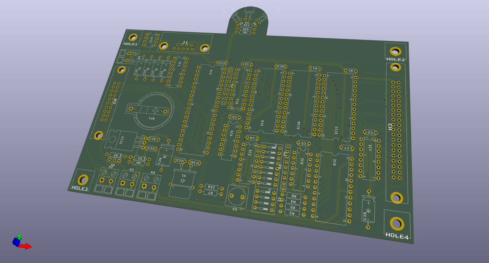
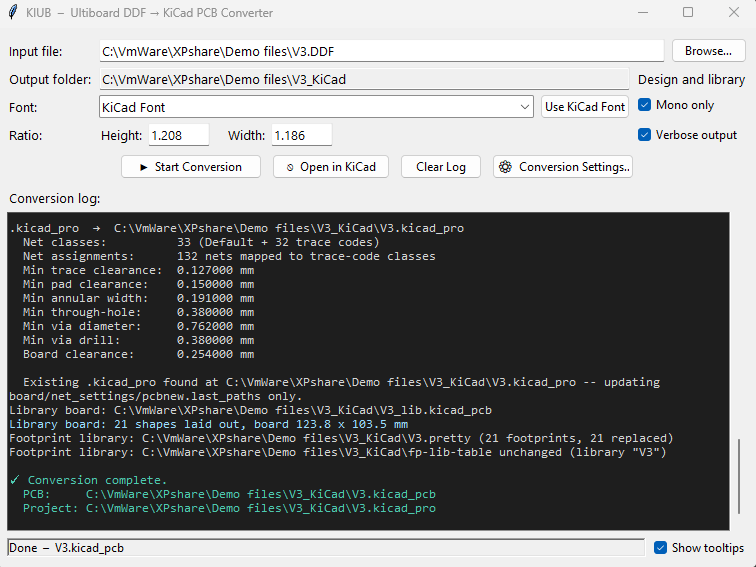
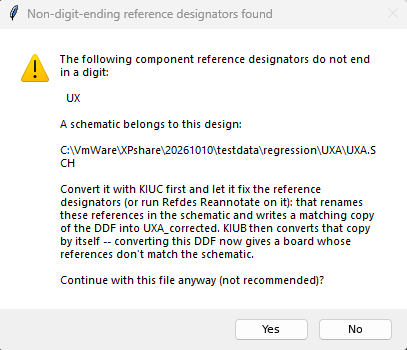
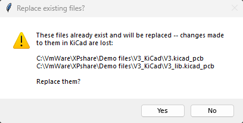
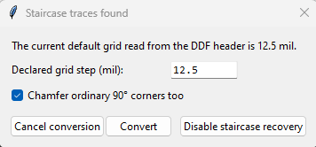
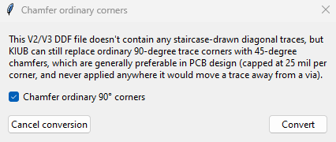
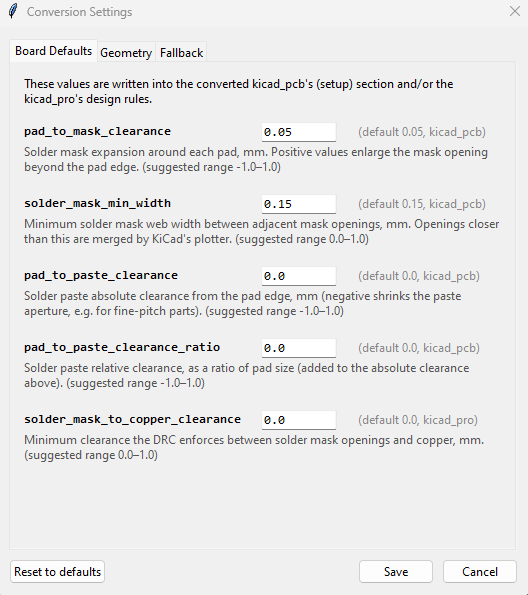
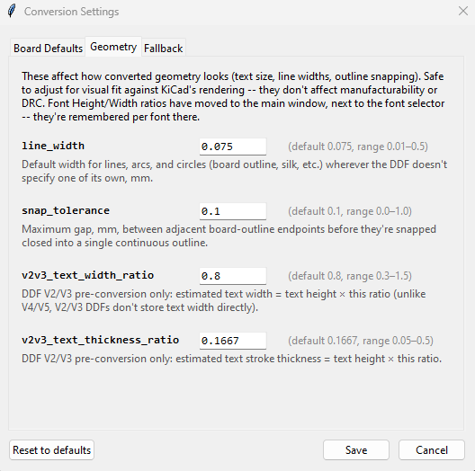
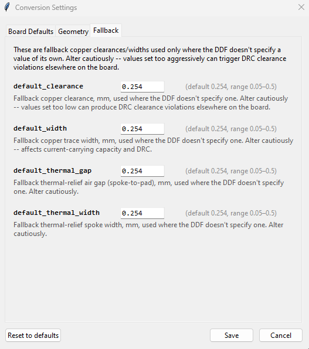

# Ultiboard DDF, LIB and L55 to KiCad Converter (KIUB)
**Python:** 3.13+ | **License:** GPLv3 | **Target:** KiCad v9+

><ins>**Legal Notice**</ins>\
[KIUB](https://github.com/Snieffy/ultiboard-ddf-to-kicad-converter) is a functional acronym for <ins>**Ki**</ins>Cad <ins>**U**</ins>lti<ins>**B**</ins>oard Converter.\
This is an independent, open-source project and is not affiliated with, sponsored by, or endorsed by any companies sharing a similar name.\
[Ultiboard](https://www.ni.com/nl-be/shop/product/ultiboard.html) is a registered trademark of National Instruments (formerly Ultimate Technology / Electronics Workbench).\
[KiCad](https://www.kicad.org/) is a free software suite for electronic design automation.\
This tool is provided "as-is" for file migration purposes only.

KIUB converts Ultiboard ASCII layout files (`.DDF`) and compiled Ultiboard shape libraries
(`.LIB`, `.L55`) to KiCad 9 PCB format (`.kicad_pcb`) and KiCad footprint libraries (`.pretty`).\
It is the PCB counterpart to [KIUC](https://github.com/Snieffy/ulticap-sch-to-kicad-converter),
which converts Ulticap schematic files to KiCad schematic format.

---

## License & Originality

This project is licensed under the **GNU General Public License v3.0 (GPLv3)**.

This software is an original work. No Ultiboard source code, proprietary algorithms, or confidential
materials were used or referenced in its development. The implementation is based entirely on
independent analysis of publicly observable file format behaviour and the 1997 Ultiboard reference manual.

> [!NOTE]
> **Coming:** KIUC and KIUB are being combined into one application that converts a design's
> schematic and board together, with further tools. Until then, both converters work as described
> here and already share one KiCad project per design (see [CORRECTED_FOLDER.md](CORRECTED_FOLDER.md)).

### Development History

KIUB represents a fundamental evolution and complete refactoring of earlier community-driven conversion
concepts. While the electronics industry has moved forward, many valuable legacy designs remain locked
in Ultiboard's proprietary formats. KIUB provides a bridge, allowing engineers to revive and maintain
these designs within the powerful, open-source KiCad ecosystem.

- **Primary Research:**\
  The core parsing logic and technical specifications are derived from the\
  **Ultiboard 32-bit DOS and Windows 95 — Reference Manual — Appendix A — File Formats (1997-08-15)**,\
  supplemented by extensive empirical testing against real Ultiboard DDF files spanning V2.x through V5.x.\
  A full reverse-engineered description of the ASCII DDF file format is provided in [FILEFORMAT-DDF.md](FILEFORMAT-DDF.md),\
  and of the compiled shape libraries (`.LIB`, `.L55`) and technology files (`.TEC`) in
  [FILEFORMAT-LIB.md](FILEFORMAT-LIB.md).
- **Modern Implementation:**\
  KIUB is a **clean-room-inspired rewrite** in Python 3.13. It abandons procedural limitations in
  favor of a modern, object-oriented architecture.
- **Independent Logic:**\
  Mathematical errors found in abandoned legacy scripts (e.g., arc midpoint calculations and layer
  mapping) have been corrected to ensure compatibility with **KiCad v9+**. Format details the
  reference manual does not document were determined by direct observation of real files across
  the supported version range; FILEFORMAT-DDF.md records them, together with the manual's errata.
- **Binary libraries:**\
  The manual does not describe the compiled libraries. The `.LIB`/`.L55` reader is based on
  analysis of real V4.91 and V5.72 libraries and comparison with the DDF files they were compiled
  from; the technology handling, including Ultiboard's own V4 → V5 unit conversion, on comparison
  of `.TEC` files with the technology those DDF files hold.
- **Code and documentation:**\
  KIUB's original code was written by the author. Its further development was then handed to an
  AI assistant (Claude, by Anthropic). That covers fixing issues found along the way, adding the
  GUI, extending its capabilities and writing the documentation, working from the author's test
  data, findings and design decisions. The author supplied the real Ultiboard designs, ran every
  test in Ultiboard and KiCad, and decided how each problem was to be solved.

---

## Key Features

- Converts Ultiboard ASCII `.DDF` files to KiCad 9 `.kicad_pcb`, with a matching `.kicad_pro`
  populated from the DDF's own technology data (netclasses, DRC rules, net-to-tracecode assignments),
  and compiled Ultiboard libraries (`.LIB` V4, `.L55` V5), together with the technology (`.TEC`
  data) the library was made with (see "Ultiboard libraries" below)
- Supports the full range of tested versions: V2.x, V3.x, V4.x, and V5.x
  - V2.x/V3.x data is translated by a separate pre-processor (`kiub_v2v3.py`) before reaching the main converter
  - Diagonal traces drawn as V2.x/V3.x "staircases" (the format has no native 45° trace record) are
    recovered as true diagonal traces, and ordinary 90° trace corners can optionally be chamfered to
    45° as well
- Precision handling of tracks, vias, pads (SMD & THT), and complex copper zones
- Accurately converts Ultiboard's internal font encoding to KiCad-compatible text. Best results come
  from KiCad's default font, DejaVu Sans Mono, or the purpose-built **Ultiboard Stroke** font created
  to visually match Ultiboard's own native PCB font — see "Font and Ratio" below for how to install it
- Automatic mapping of Ultiboard layer stackups to KiCad's signal and technical layers
- Board outline reconstruction: separates the true board edge from internal partition/divider lines
  sharing the same outline data stream
- Every conversion also writes a library board, with every shape the input defines — placed or
  not — laid out once to review them, and a KiCad footprint library `<name>.pretty` registered in the
  project's footprint library table, to browse and place new parts from (see "What a conversion
  writes" below)
- Writes into the design's own KiCad project folder, `<name>_KiCad` next to the input — the folder
  [KIUC](https://github.com/Snieffy/ulticap-sch-to-kicad-converter) writes the design's schematic
  into, so board and schematic form one KiCad project (see "What a conversion writes" below)
- Never writes the original files: a V2/V3 DDF's V4.60 conversion goes into `<name>_corrected`,
  the folder KIUC writes its corrections into too, and each tool builds on the other's corrections
  (see [CORRECTED_FOLDER.md](CORRECTED_FOLDER.md))
- GUI front-end with per-font settings memory, a tabbed Conversion Settings dialog, and interactive
  pop-ups for V2/V3-specific choices (see "GUI" below)
- Zero external dependencies beyond the Python standard library (tkinter for the GUI only)



---

## Project Files

| File | Run it | Purpose | Uses |
|---|---|---|---|
| `kiub_gui.py` | yes (GUI) | The window for every conversion: settings, pre-conversion questions, log, Open in KiCad | `kiub.py`; tkinter |
| `kiub.py` | yes (CLI) | The converter: DDF → `.kicad_pcb`/`.kicad_pro`, the library board and the footprint library | `kiub_v2v3.py` (V2/V3 input), `kiub_library.py`, `kiub_corrected.py` |
| `kiub_v2v3.py` | also on its own | Pre-converts a V2/V3 DDF to V4.60, including staircase-to-diagonal recovery and chamfering | — |
| `kiub_library.py` | no | The library board layout, the footprint library and its `fp-lib-table` entry, the `.LIB`/`.L55`/`.TEC` readers | — |
| `kiub_corrected.py` | no | The design's corrected folder `<name>_corrected` and its manifest, shared with KIUC (its `kiuc_corrected.py`) | — |

All five use the Python standard library only (tkinter for the GUI only) and must sit in one
folder: `kiub.py` loads the other three from its own folder.

| Other files | |
|---|---|
| [FILEFORMAT-DDF.md](FILEFORMAT-DDF.md) | The ASCII DDF file format |
| [FILEFORMAT-LIB.md](FILEFORMAT-LIB.md) | The compiled shape libraries (`.LIB`, `.L55`) and technology files (`.TEC`) |
| [CORRECTED_FOLDER.md](CORRECTED_FOLDER.md) | Where KIUB and KIUC put a design's files: the corrected folder, the KiCad project folder, the project libraries |
| `fonts/` | The Ultiboard Stroke font (see "Font and Ratio") |
| `DDF/` | Sample DDF files |
| `assets/` | The images of this README |

---

## Requirements

- Python 3.13 or later
- tkinter (required for the GUI only)
- KiCad v9+

The command-line converter (`kiub.py`) has no GUI dependencies at all.

tkinter ships with the standard Python installer on Windows and macOS. On Linux it is usually a
separate package:

```
sudo apt install python3-tk
```

No further installation step is required beyond the above. Download or clone the repository and run
directly from the source folder, keeping the five `.py` files (see "Project Files") together in the
same directory.

---

## Usage

### GUI

Launch the converter GUI:

```
python kiub_gui.py
```

**Input file**\
Select the Ultiboard file to convert, either by typing/pasting the path or via **Browse…**: a
`.DDF` file, or an Ultiboard library — `.LIB` (V4) or `.L55` (V5). When no file extension is given,
`.DDF` is added automatically. An Ulticap symbol library, which also uses the `.LIB` extension, is
refused with a pointer to KIUC.

**Output folder**\
The **Output folder** shows where the conversion goes: `<name>_KiCad` next to the design's files for a
design, `<name>_lib_KiCad` for a library-only input — see "What a conversion writes" under
Conversion Notes. It can't be chosen: KiCad only treats a board, schematic and project of one name in
one folder as one project, and the fixed folders let KIUB and KIUC find each other's files. To
convert a design somewhere else, copy its files there first. Beside it, KIUB shows what the input
converts to: **Design and library**, **Library only**, or **Design or library?** — a DDF that places
components but holds no nets, copper or vias, as Ultiboard's library DDFs place their shapes:
**Start Conversion** then asks whether to convert it as a library only.

**Technology (Ultiboard libraries)**\
A library holds pad and drill codes only, so **Start Conversion** first asks for the technology the
library was made with. Choose **Single file** for one `.TEC` file (Ultiboard V4.60 and later), or
**Multi-file set** for the older split layout: **Top pads**, **Bottom pads**, **Inner pads**,
**Drills** and, optionally, **Traces**. The same pad file may be picked for several pad layers. Each
file is checked as it is picked (✓/✗, with the reason below the fields), and **OK** is available
only when every needed file fits. A table that lists fewer codes than its full range is reported;
after **OK**, KIUB asks whether to continue with it (the missing codes count as undefined). The
choice is remembered in `kiub_gui.ini`.

**Font and Ratio**\
Choose the font used for converted text from the **Font** list (optionally filtered to
monospaced fonts only via **Mono only**), or click **Use KiCad Font** to reset to the KiCad
default. The list holds the installed fonts only, with **KiCad Font** first; a name can't be typed,
as a font missing on another computer would only be replaced by KiCad's own. Pressing a letter
selects the next font starting with it. A font remembered from an earlier session that is no
longer installed is replaced by KiCad Font at startup, and the log says so (on the command line,
`-f` still takes any name). The **Ratio** fields (**Height**/**Width**) next to it control `font_height_ratio`/
`font_width_ratio` — the empirically-tuned multipliers that make converted text visually match
Ultiboard's own rendering for the selected font. These are remembered **per font**: selecting a
previously-used font auto-fills its last-saved ratio, entering a value outside the suggested
1.0–1.5 range highlights the field, and the current font + ratio pair is saved only when
**Start Conversion** is clicked. Fresh installs are pre-filled with known-good values for KiCad Font, DejaVu Sans Mono, and
Ultiboard Stroke.

> [!NOTE]
> Ultiboard Stroke is not a system font by default — it won't appear in the Font dropdown until
> it's installed like any other font on your OS. The file is included in this repository as
> `fonts/UltiboardStroke-Regular.ttf`.
> - **Windows:** right-click the file → **Install** (or **Install for all users**).
> - **macOS:** double-click the file → **Install Font** in Font Book.
> - **Linux:** copy it to `~/.local/share/fonts/` (or `/usr/share/fonts/` system-wide), then run `fc-cache -f`.
>
> Restart KIUB's GUI afterwards so it picks up the newly installed font.

**Actions**

| Button⠀⠀⠀⠀⠀⠀⠀⠀⠀⠀⠀⠀⠀⠀⠀⠀⠀⠀⠀| Description |
| --- | --- |
| **▶ Start Conversion** | Run the conversion and write the `.kicad_pcb`/`.kicad_pro` files to the output folder. Triggers the automatic pre-conversion checks below first. |
| **⎋ Open in KiCad** | Open the last conversion's KiCad project in KiCad, also when another input has been chosen since; before any conversion, the chosen input's project from an earlier conversion, since the output folder is known as soon as the input is chosen. KiCad is found when needed: the saved KiCad path if it still exists, else the program your system opens `.kicad_pro` files with (KiCad's installer sets that up); only when both fail, KIUB asks where KiCad is and saves the answer, and asks again if it fails to start. Without a converted project yet: "Convert the design first". |
| **Clear Log** | Clear the on-screen conversion log. |
| **⚙ Conversion Settings…** | Opens the Conversion Settings dialog (see below). |

**Show tooltips**, at the right of the status bar, turns the hover tips off once you know the
program; it is on by default and remembered.

The conversion log (verbose or brief, depending on **Verbose output**) is shown on-screen and also
written to a `_log.txt` file in the output directory. Choosing another input file clears the log.



**Automatic pre-conversion checks**\
Before Start Conversion actually runs, KIUB checks the input file in order: the technology of an
Ultiboard library, the design-or-library question, a `<name>_V3.DDF` kept by an earlier KIUB, the
design's corrected folder, reference designators, staircase/chamfer detection for V2/V3 files, and
finally existing output files. Each can stop the conversion if declined. A library-only conversion
needs no corrected folder, designator check or staircase question: it writes no corrected copy,
converts no traces and names its components `S1`, `S2`, …

**V2/V3 files and the corrected folder**\
KIUB never writes a design's original files. A V2/V3 DDF is converted to V4.60, and that V4.60 DDF
is written as `<name>_corrected\<name>.DDF`, next to the original, under its own name — the folder
KIUC writes its corrections into as well (its reference-designator fix, for instance). Every
conversion reads each file from `<name>_corrected` when a copy is there, else the original, so
KIUB's V4.60 DDF and KIUC's reannotated DDF build on each other, whichever tool runs first. The
folder's manifest `_corrected.json` records each original as it was when it was copied, so KIUB
notices:

- **An original changed since its copy was made** (also a schematic sheet KIUC copied): the copies
  are out of date, and KIUB asks to **redo from the originals** (the default) or cancel. A redo
  removes the folder's copies; KIUC redoes its own corrections on its next run.
- **A copy changed since it was written** (edited by hand, e.g. saved in Ultiboard): it is read as
  it is. If a redo would throw it away, the question defaults to Cancel.

The V4.60 copy is made once: the staircase, chamfer and V2/V3 text settings of that conversion stay
until the copies are redone, and the log says so when the copy is used. To convert again with other
V2/V3 settings, remove `<name>_corrected` (KIUC redoes its own corrections on its next run). Adopting
the corrections is copying the folder's design files over the originals. A file picked inside
`<name>_corrected` belongs to the design `<name>`: its output goes to the parent folder's
`<name>_KiCad`. When the folder of the originals can't be written to (a CD, a read-only share), the
conversion is refused. [CORRECTED_FOLDER.md](CORRECTED_FOLDER.md) describes the folder for both
tools. Every DDF file KIUB writes ends in a genuine blank line, which Ultiboard requires to open a
DDF correctly.

Earlier versions of KIUB replaced `<name>.DDF` itself with the V4.60 conversion and kept the original
as `<name>_V3.DDF`. Converting such a `<name>_V3.DDF` would make it a design of its own: KIUB says
so and asks first (default No) — to convert the design from that original, copy it over
`<name>.DDF` and convert `<name>.DDF`.

**Reference designators**\
When the DDF contains reference designators that don't end in a digit (e.g. `TP`, `FID`), KiCad
will treat these as unannotated. KIUB shows the offending list and looks for the design's
schematic: `<name>.SCH`, `<name>.UTSCH` or `<name>.kicad_sch` next to the DDF, or
`<name>.kicad_sch` in the design's `<name>_KiCad` folder (any letter case). If there is one,
convert it with [KIUC](https://github.com/Snieffy/ulticap-sch-to-kicad-converter) first and let it
fix the reference designators (or run its Refdes Reannotate): it renames these references in the
schematic and writes a matching copy of the DDF into `<name>_corrected`. KIUB then converts that
copy by itself, so board and schematic stay in sync, and the question no longer comes up. Until
then the question defaults to stopping the conversion. Without a schematic you can simply
continue: KiCad's PCB editor accepts non-digit-ending references without issue.



**Existing files**\
When `<name>.kicad_pcb` or `<name>_lib.kicad_pcb` already exists in the output folder, KIUB lists
them and asks before replacing them (default: no): changes made to them in KiCad would be lost. The
`.kicad_pro` is updated rather than replaced, and the footprints in `<name>.pretty` are replaced
without asking.



**Staircase-to-diagonal recovery and chamfering**\
When a V2/V3 file contains diagonal traces drawn as staircases, a pop-up shows the file's declared
routing grid (editable) and lets you disable staircase recovery and/or chamfering for that
conversion. If no staircases are found, a smaller pop-up still offers the chamfering option, since
it applies independently of staircase recovery — but only when the conversion would chamfer at
least one corner; otherwise the log says there is nothing to chamfer. The log reports how many
corners were chamfered.

Chamfering trims each leg of a 90° corner by at most the routing grid (25 mil at most) and at most
half of either leg, and never at the corner nearest a via of the trace's own net. The trim is also
capped by the trace's own width *w* and clearance *c* from its trace code: at most
(2 − √2)·*c* + (1 − √2/2)·*w*, about 0.59·*c* + 0.29·*w* — 9 mil for a 12.5 mil trace with 9.2 mil
clearance. With that cap, a chamfer never brings a trace closer to other copper (a pad or via it
was routed around) than the clearance its corner already kept, and a trace turning at a pad's
centre keeps its end inside any pad wider than about twice the trim. Wide traces therefore keep a sharp inner corner sooner. Closed loops of
traces (a ring or frame) are not chamfered, and staircase recovery is not affected.




**Conversion Settings**\
A single tabbed dialog covering board-default values and fine-tuning constants. Alter these
cautiously — wrong values can result in DRC errors. Changes take effect on the next conversion and
are saved to `kiub_gui.ini`.

*Board Defaults* — written into the converted `.kicad_pcb`'s `(setup)` section and/or the
`.kicad_pro`'s design rules:

| Parameter⠀⠀⠀⠀⠀⠀⠀⠀⠀⠀⠀⠀⠀⠀⠀⠀⠀⠀⠀⠀⠀⠀⠀⠀⠀⠀⠀⠀⠀⠀⠀| Default | Description |
| --- | :---: | --- |
| **pad_to_mask_clearance** | 0.05 | Solder mask expansion around each pad, mm. Positive values enlarge the mask opening beyond the pad edge. |
| **solder_mask_min_width** | 0.15 | Minimum solder mask web width between adjacent mask openings, mm. Openings closer than this are merged by KiCad's plotter. |
| **pad_to_paste_clearance** | 0.0 | Solder paste absolute clearance from the pad edge, mm (negative shrinks the paste aperture, e.g. for fine-pitch parts). |
| **pad_to_paste_clearance_ratio** | 0.0 | Solder paste relative clearance, as a ratio of pad size (added to the absolute clearance above). |
| **solder_mask_to_copper_clearance** | 0.0 | Minimum clearance the DRC enforces between solder mask openings and copper, mm. |



*Geometry* — affect how converted geometry looks (text size, line widths, outline snapping). Safe
to adjust for visual fit against KiCad's rendering; they don't affect manufacturability or DRC.
Font Height/Width ratios have moved to the main window, next to the font selector — see "Font and
Ratio" above.

| Parameter⠀⠀⠀⠀⠀⠀⠀⠀⠀⠀⠀⠀⠀⠀⠀⠀⠀⠀⠀| Default | Description |
| --- | :---: | --- |
| **line_width** | 0.075 | Default width for lines, arcs, and circles (board outline, silk, etc.) wherever the DDF doesn't specify one of its own, mm. |
| **snap_tolerance** | 0.1 | Maximum gap, mm, between adjacent board-outline endpoints before they're snapped closed into a single continuous outline. |
| **v2v3_text_width_ratio** | 0.8 | DDF V2/V3 pre-conversion only: estimated text width = text height × this ratio (unlike V4/V5, V2/V3 DDFs don't store text width directly). |
| **v2v3_text_thickness_ratio** | 0.1667 | DDF V2/V3 pre-conversion only: estimated text stroke thickness = text height × this ratio. |



*Fallback* — copper clearances/widths used only where the DDF doesn't specify a value of its own.
Alter cautiously — values set too aggressively can trigger DRC clearance violations elsewhere on
the board.

| Parameter⠀⠀⠀⠀⠀⠀⠀⠀⠀⠀⠀⠀⠀⠀⠀⠀⠀⠀⠀⠀⠀⠀⠀| Default | Description |
| --- | :---: | --- |
| **default_clearance** | 0.254 | Fallback copper clearance, mm, used where the DDF doesn't specify one. |
| **default_width** | 0.254 | Fallback copper trace width, mm, used where the DDF doesn't specify one. Affects current-carrying capacity and DRC. |
| **default_thermal_gap** | 0.254 | Fallback thermal-relief air gap (spoke-to-pad), mm, used where the DDF doesn't specify one. |
| **default_thermal_width** | 0.254 | Fallback thermal-relief spoke width, mm, used where the DDF doesn't specify one. |



**Settings file**\
The GUI persists its own settings to `kiub_gui.ini`, created next to `kiub_gui.py` — but not until
something actually needs saving; opening the GUI by itself creates nothing. Each section is added
independently, the first time its own setting is actually used: `[kicad]` (KiCad executable path,
once Open in KiCad needed to ask for it), `[ui]` (Show tooltips), `[board_defaults]`/`[fine_tuning]`
(Conversion Settings dialog values), and `[font_ratios]`/`[last_used]` (per-font Height/Width ratio memory — see "Font and
Ratio" above). In practice, `[font_ratios]`/`[last_used]` are usually the first to appear, written
together the first time **Start Conversion** is clicked — at that point all three known fonts are
saved at once, not just whichever one was in use. This file holds local machine state (it can end
up recording a local KiCad install path), so it isn't part of this repository — if you keep this
folder under version control yourself, add `kiub_gui.ini` to your own `.gitignore`.

---

### Command Line

```
python kiub.py test.ddf
```

```
python kiub.py "C:\source_folder\test" -f "DejaVu Sans Mono"
```

When no file extension is specified, `.DDF` is added to the input file. The output goes to the
folder `<name>_KiCad` (a design) or `<name>_lib_KiCad` (a library-only input) next to the design's
files, named after the design, and can't be chosen — see "What a conversion writes" under
Conversion Notes.

```
python kiub.py shapes.ddf --library-only
```

```
python kiub.py shapes.lib --tec design.tec
python kiub.py shapes.lib --tec-split top.tec bot.tec inn.tec dri.tec tra.tec
```

| Option⠀⠀⠀⠀⠀⠀⠀⠀⠀⠀⠀⠀⠀⠀⠀⠀⠀⠀⠀⠀⠀⠀⠀⠀⠀⠀⠀⠀⠀⠀⠀⠀⠀⠀⠀⠀⠀⠀⠀⠀⠀⠀⠀⠀⠀⠀⠀⠀| Description |
|---|---|
| `infile` | Path/name of the Ultiboard DDF file, or of an Ultiboard library (`.LIB` V4, `.L55` V5), which converts to a library only and needs `--tec` or `--tec-split`. |
| `-f` / `--font` | Replace the default KiCad font with a user-specified font during conversion. Optimal results are obtained using Ultiboard Stroke or DejaVu Sans Mono — see the font ratio flags below. Default: `KiCad Font`. |
| `-v` / `--verbose` | Print progress information during conversion. |
| `--library-only` | Convert a DDF to a library only: the library board and the footprint library, no design board. A V2/V3 file is pre-converted in memory; no corrected copy is written. Without it, a DDF that places components but holds no nets, copper or vias gets this question (answer `y` for a library only). |
| `--tec FILE` | The technology of an Ultiboard library: one single-file `.TEC` (Ultiboard V4.60 and later). |
| `--tec-split TOP BOTTOM INNER DRILLS [TRACES]` | The technology of an Ultiboard library as an older multi-file set: the top, bottom and inner pad files, the drill file and, optionally, the trace file. The same pad file may be given for several layers. |
| `--yes` | Do not prompt; continue automatically. Covers non-digit-ending reference designators, incomplete technology tables of an Ultiboard library, the design-or-library question (a design then), an earlier KIUB's `<name>_V3.DDF` (a design of its own then) and existing boards (replaced). Corrected copies out of date take the default answer: redo from the originals, or cancel when copies edited by hand would be lost. Needed for non-interactive/scripted use. |

**Board defaults** — written into the converted `.kicad_pcb`'s `(setup)` section and/or the
`.kicad_pro`'s design rules; mirrors the GUI's Board Defaults tab:

| Option | Description |
|---|---|
| `--pad-to-mask-clearance` | Solder mask expansion around each pad, mm. Positive values enlarge the mask opening beyond the pad edge. Default: `0.05`, suggested range `-1.0`–`1.0`. |
| `--solder-mask-min-width` | Minimum solder mask web width between adjacent mask openings, mm. Default: `0.15`, suggested range `0.0`–`1.0`. |
| `--pad-to-paste-clearance` | Solder paste absolute clearance from the pad edge, mm. Default: `0.0`, suggested range `-1.0`–`1.0`. |
| `--pad-to-paste-clearance-ratio` | Solder paste relative clearance, as a ratio of pad size. Default: `0.0`, suggested range `-1.0`–`1.0`. |
| `--solder-mask-to-copper-clearance` | Minimum clearance the DRC enforces between solder mask openings and copper, mm. Default: `0.0`, suggested range `0.0`–`1.0`. |

**Fine-tuning (geometry)** — visual fit against KiCad's rendering; doesn't affect manufacturability
or DRC; mirrors the GUI's Geometry tab and the main window's Font/Ratio fields:

| Option | Description |
|---|---|
| `--font-height-ratio` | KiCad text height = Ultiboard text height ÷ this ratio. Default: `1.208`, suggested range `1.0`–`1.5`. |
| `--font-width-ratio` | KiCad text width = Ultiboard text width × this ratio. Default: `1.186`, suggested range `1.0`–`1.5`. |
| `--line-width` | Default width for lines, arcs, and circles wherever the DDF doesn't specify one, mm. Default: `0.075`, suggested range `0.01`–`0.5`. |
| `--snap-tolerance` | Maximum gap, mm, between adjacent board-outline endpoints before they're snapped closed. Default: `0.1`, suggested range `0.0`–`1.0`. |

**Fine-tuning (fallback clearance)** — alter cautiously; mirrors the GUI's Fallback tab:

| Option | Description |
|---|---|
| `--default-clearance` | Fallback copper clearance, mm, used where the DDF doesn't specify one. Default: `0.254`, suggested range `0.05`–`0.5`. |
| `--default-width` | Fallback copper trace width, mm, used where the DDF doesn't specify one. Default: `0.254`, suggested range `0.05`–`0.5`. |
| `--default-thermal-gap` | Fallback thermal-relief air gap (spoke-to-pad), mm, used where the DDF doesn't specify one. Default: `0.254`, suggested range `0.05`–`0.5`. |
| `--default-thermal-width` | Fallback thermal-relief spoke width, mm, used where the DDF doesn't specify one. Default: `0.254`, suggested range `0.05`–`0.5`. |

**V2/V3 pre-conversion options** — only apply when converting a V2.x/V3.x DDF file; no effect on
native V4.x/V5.x files:

| Option | Description |
|---|---|
| `--v2v3-text-width-ratio` | Estimated text width = text height × this ratio (V2/V3 DDFs don't store text width directly). Default: `0.8`, suggested range `0.3`–`1.5`. |
| `--v2v3-text-thickness-ratio` | Estimated text stroke thickness = text height × this ratio. Default: `0.1667`, suggested range `0.05`–`0.5`. |
| `--v2v3-staircase-limit-mil MIL` | Maximum length (mil) for a single staircase grid step recovered as a diagonal trace. Default: the file's own declared default grid step, always capped at a fixed 25 mil ceiling regardless of this override or the file's declared grid. |
| `--v2v3-no-staircase-merge` | Disable staircase-to-diagonal recovery entirely (default: enabled). |
| `--v2v3-corner-slant-limit-mil MIL` | Maximum length (mil) to trim off each leg of an ordinary 90° trace corner when chamfering it. Default: tracks `--v2v3-staircase-limit-mil` (or its own auto default, if that isn't set either). Always capped by each trace code's own width and clearance (see "Staircase-to-diagonal recovery and chamfering"). |
| `--v2v3-no-chamfer` | Disable corner-slanting (chamfering ordinary 90° trace corners) entirely (default: enabled). |

A few things run automatically on the CLI with no flag needed: the V4.60 copy of a V2/V3 DDF in
`<name>_corrected` (see "V2/V3 files and the corrected folder" above), and staircase/chamfer
recovery itself (use the flags above only to change its limits or disable it). The CLI asks only
where the GUI asks too: corrected copies out of date (`[Y/n]`, or `[y/N]` when copies edited by hand
are at stake), an earlier KIUB's `<name>_V3.DDF`, non-digit-ending reference designators (the list
with the advice above), incomplete technology tables of an Ultiboard library, the
design-or-library question, and existing boards to be replaced — each other question defaults to no
(a design, for the design-or-library question); `--yes` continues without asking. With no answer to
read (a scheduled run), the default is taken, and the output says so.

> [!NOTE]
> The `DDF` folder contains sample DDF files to demonstrate the conversion capabilities.
>
> Polygons need to be reconstructed once the file is opened in KiCad, as only the outline and hatch
> settings are copied. Either open the 'Edit' menu and select 'Fill all zones', or press the 'B'
> key. Don't forget to save the updated design.

---

## Conversion Notes

The software has been thoroughly tested against many different PCB designs. Even though great care
has been taken to accurately mimic the DDF design in KiCad, small differences are still possible.

> [!NOTE]
> KIUB creates PCB files readable by KiCad v9. While the design data itself is accurate, KiCad
> performs a one-time update of the S-expression notation the first time the converted file is
> opened.

Implementation and behaviour notes below cover how KIUB's own choices show up in the converted
`.kicad_pcb`/`.kicad_pro`, and how to work with that output in KiCad. For the DDF file format
itself — record layouts, rotation/layer encoding, font handling, board-outline reconstruction, and
known errata in the original Ultiboard reference manual — see [FILEFORMAT-DDF.md](FILEFORMAT-DDF.md).

**What a conversion writes**\
Every file goes into one folder next to the input, so the input's own folder stays readable, and is
named after one name, `<name>`:

| Input | Folder | Files |
|---|---|---|
| A design (a DDF with nets, copper or vias, or placed components) | `<name>_KiCad` | `<name>.kicad_pcb` and `.kicad_pro` (the design), `<name>_lib.kicad_pcb` and `.kicad_pro` (the library board), `<name>.pretty` and `fp-lib-table` (the footprint library) |
| A library-only input: an Ultiboard library (`.LIB`, `.L55`), a DDF without components, nets, copper or vias, or a DDF converted with `--library-only` | `<name>_lib_KiCad` | `<name>_lib.kicad_pcb` and `.kicad_pro`, `<name>.pretty` and `fp-lib-table` |

The GUI also writes its log, `<name>_log.txt`. A DDF that places components but holds no nets,
copper or vias may be either — Ultiboard's library DDFs place their shapes as components — so KIUB
asks which (CLI: `[y/N]` for a library only; `--yes` converts it as a design).

`<name>` is the design name: the input's name — for a file picked inside `<name>_corrected`, the
design `<name>` it belongs to. The folders sit next to the design's original files and can't be
chosen. KIUC writes the design's schematic into the same `<name>_KiCad` folder: the `.kicad_pcb`,
`.kicad_sch` and the one `<name>.kicad_pro` together form the design's KiCad project. A V2/V3
design's V4.60 DDF goes into `<name>_corrected` (see "V2/V3 files and the corrected folder"). An
existing `.kicad_pro` is updated, not replaced: KIUB sets only its board and net settings, its file
name and the PCB editor's last paths, and keeps everything else, KIUC's schematic settings
included; a project file KIUB creates holds only those. Existing boards are only replaced after
asking (see "Existing files"). [CORRECTED_FOLDER.md](CORRECTED_FOLDER.md) describes the layout for
KIUB and KIUC together.

**Linking board and schematic in KiCad**\
KiCad links a footprint to its schematic symbol through identifiers that KIUB and KIUC, converting
independently, cannot share: a converted board and schematic open in one project but are not yet
linked. Link them once in KiCad's PCB editor with **Tools → Update PCB from Schematic…**, with
**Re-link footprints to schematic symbols based on their reference designators** ticked: KiCad
pairs footprints and symbols by reference designator; leave **Replace footprints with those
specified in the schematic** unticked. This requires matching designators on both sides — which
KIUC's reference-designator fix ensures, as both tools then read its copies in `<name>_corrected`
(see "Reference designators"). The board's footprints and the schematic's Footprint fields both read
`Ultiboard:<footprint>` (KIUC takes the footprint the board places for each part), so KiCad finds
nothing to change.

**Library board**\
A DDF holds every shape it defines, placed or not, but its design board holds footprints only for
placed components: a shape the DDF defines but never places would not reach KiCad. So KIUB also
writes the library board `<name>_lib.kicad_pcb`: it keeps the DDF's header and technology data (the
pads need it) and lays out every shape exactly once — in the DDF's own order, unrotated, on the
front side, packed in rows by size with 0.2" between shapes — on a new rectangular board. How the
DDF itself places its shapes does not matter: its components, nets, copper, vias, power planes,
texts and board outline are left out. Each shape becomes component `S1`, `S2`, … with the shape's
name as its value, both texts at the shape's own text positions. The board shows every shape at a
glance — including shapes no design ever used, and faulty ones. A library-only input without
shapes is refused; a design without shapes gets its design board only.

A shape whose pads have no size in the DDF's technology data (see Pads below) is marked with a
rectangle and both its diagonals around its outline and pads, on the user layer `KIUB.Check`
(`User.1`), and the log names the shape and pad codes. The mark is part of the footprint, so it also
goes into the footprint library and keeps flagging the footprint there: delete it once the pads are
fixed (on the board, or in KiCad's footprint editor). KiCad takes a layer's colour from the
user's colour theme, not from the board: give `KIUB.Check` a striking colour such as red once in the
Appearance panel, and every library board shows the marks in it. A design board does not mark
shapes and does not name the layer.

**Footprint library**\
KIUB writes a KiCad footprint library `<name>.pretty`: one `.kicad_mod` file for every footprint of
the library board, so for every shape the input defines, placed or not (at the origin, unrotated, on
the front side, reference `REF**`, check marks included). With it, a footprint for a new component
is in the library rather than copied from another board. KIUB adds the library to the folder's
footprint library table `fp-lib-table` (created if needed) as `<name>`, with the path
`${KIPRJMOD}/<name>.pretty`, to browse and to place new parts from. The boards' footprints are not
tied to it: they read `Ultiboard:<footprint>`, a library name no table lists, so each footprint
stays the one the board embeds — a design is often edited without exporting its shapes again, and
KiCad's *Update from library* would otherwise replace a footprint with a library entry of the same
name without warning. Tying a design to the library is a deliberate step in KiCad. The same name is
what KIUC writes in a symbol's Footprint field. Converting again replaces the library's
footprints of the same name and reports how many; other files in the `.pretty` folder, and other
libraries in the table, are left as they are; a table not laid out as KiCad writes it is left
unchanged, and the log says so. KiCad
does not allow `\ / : * ? " < > |` in a footprint name: such a character becomes `_` in the
footprint's name (its value keeps the shape's own name), and the log lists the renamed shapes; names
that would then differ only in letter case get `_2`, `_3`, …

**Ultiboard libraries**\
A compiled Ultiboard library (`.LIB` for V4, `.L55` for V5) holds each shape exactly as a DDF does,
but no technology: a pad refers to a pad code and a drill code whose sizes are defined in the
technology of the design the library was made with. That is why a library converts only with its
`.TEC` data. KIUB combines both into the shapes and technology of a DDF and converts it to a library
only, so `<name>_lib.kicad_pcb` is the same board the library's source DDF gives.
The log names the library, its version and number of shapes, and the technology files used. The
library and `.TEC` formats are described in [FILEFORMAT-LIB.md](FILEFORMAT-LIB.md).

- Technology in other units than the library (V4 `.TEC` data for a V5 library, or the other way
  round) is converted, as Ultiboard itself converts V4 technology to V5, and the log says so. A
  nonzero value never becomes 0, so pads marked as having no hole keep that mark.
- A library holds shape names of at most 12 characters; the log counts the names of exactly 12
  characters, which may have been shortened when the library was compiled.
- A library slot that does not hold a readable shape is left out and named in the log; a library
  without any readable shape is refused.
- The board clearance (KiCad's `min_copper_edge_clearance`) is a design setting no `.TEC` file
  holds, so the `.kicad_pro` gets KIUB's default clearance.
- When the library's source DDF is still available, converting it is the more faithful route: its
  technology is the one its shapes were made with.

**Board setup**\
Paper size is derived from the DDF's own board extents and set automatically, A5 up to A0. Solder
mask minimum width defaults to `0.15` mm in the generated `.kicad_pcb` header, tunable in the GUI's
Conversion Settings dialog (Board Defaults tab) or via `--solder-mask-min-width`.

**Pads**\
Through-hole pads become an SMD pad plus a separate through-hole pad, both sharing the same
pin/net number. Since the real pad geometry already lives on the SMD pad, the through-hole pad's
own size no longer needs to match it — only the drill diameter matters for connectivity — but
KiCad still requires a through-hole pad's size to exceed its drill size, so KIUB sets it to drill
diameter + 0.01 mm. This construction causes KiCad's DRC to report a "Padstack is questionable (SMD
pad has no outer layer)" warning; KIUB disables that specific warning in the generated
`.kicad_pro`. Separately, KiCad's PCB view will not display an Inner-layer pad if that layer is
otherwise padless on that pad stack (an apparent KiCad bug) — the 3D viewer shows it correctly
regardless. A pad whose pad code has no size in the DDF's technology tables comes out with size 0
(KiCad pins it to 1 µm when loading the file); the conversion log names each shape and pad code
concerned. Zero-diameter drill codes (the SMD-trick sentinel) and NPTH handling for drill-only
codes are DDF-format-level behaviour — see FILEFORMAT-DDF.md
[§10.4](FILEFORMAT-DDF.md#104-drill-codes-and-the-smd-trick) and
[§2](FILEFORMAT-DDF.md#2-technology-data--t-records).

**Pad clearance and the mass pad-clearance reset**\
Each pad's clearance, as read from the DDF, is written directly into that pad's own definition in
the KiCad file. In KiCad, a pad's local clearance override always takes priority over both the
board-wide default clearance and any zone/polygon clearance — so a copper pour using a different
clearance than a pad's local value will still back off to that pad's local value, not the pour's
own. If you want a polygon's own clearance to govern pad clearances as well, all pad clearances
need to be forced back to `0` (KiCad's "fall back to default/polygon clearance" sentinel) after
conversion:

1. **Configure the Selection Filter** — bottom-right corner of the PCB Editor — and uncheck
   everything except *Pads*.
2. **Select all pads** — click inside the layout area, then `Ctrl+A`.
3. **Open the Properties panel**, if not already open: *View → Panels → Properties*.
4. **Set clearances to 0** — in the Properties panel's *Overrides* section, set *Clearance
   Override* to `0`.
5. **Re-pour zones** — press `B` to update all copper zones with the new clearances.

**Vias**\
Ultiboard allows non-round via shapes; KiCad's standard vias support round shapes only, so every
via is converted to round using the DDF's own annular-ring and pad-size data per layer (F.Cu, B.Cu,
In*.Cu) — see FILEFORMAT-DDF.md
[§10.7](FILEFORMAT-DDF.md#107-known-errata-in-the-1997-reference-manual) for the non-round-via
erratum this addresses.

Ultiboard also accepts vias whose via code lacks a drill or a pad; KiCad does not. A via without a
drill gets a 0.001 mm drill, so its layers stay connected — **tell the manufacturer these holes are
not to be drilled**. A via without a pad gets a pad 0.01 mm larger than its drill, and a via with
neither is left out. The conversion log lists every such via; see FILEFORMAT-DDF.md
[§7](FILEFORMAT-DDF.md#7-vias--v). To mimic Ultiboard, which allowed these holes, the generated
`.kicad_pro` reports "Hole size out of range" as a warning, not an error.

---

## Contributing

Contributions are welcome! If you find edge cases in specific DDF versions, please open an issue or submit a pull request.\
As this project is GPLv3, all derivatives must remain open and free.
